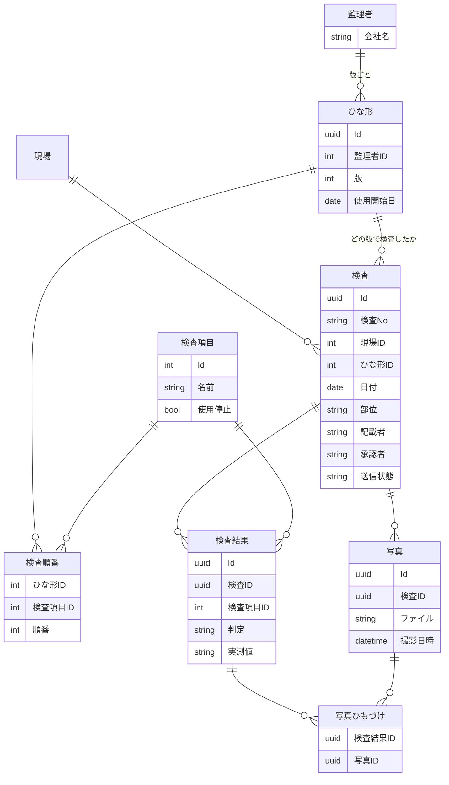

# 第3回 場面1・開発: データモデル設計（ER図）

学習日: 2026-10-19

## 場面

キックオフの翌週、社内エンジニアから「まず何を保存するのか、表の形で見せてほしい」と頼まれる。
10/22ごろの部長への計画提出（場面1の約束）の土台にもなる。宿題のうち「監理者ごとの違い」「オフライン」をデータの面から考える。

## 予習の問いと答え

| 問い | 自分の答え | 講評 |
|---|---|---|
| 紙のチェックシート1枚に何が書いてあるか | 上の欄（タイトル・日付）、真ん中（表の列）、下の欄（印鑑・記載者・承認者） | 良い: 3つに分けた見方がそのまま表の候補になる。足りない: 上の欄に現場・部位・監理者がないと「どの検査か」を探せない |
| 写真は何枚つき、どの項目にひもづくか | 1枚で複数項目が多い。1項目に複数枚もありそう | 良い: **両方向に複数ある（多対多）**と気づいた。今日いちばん大事な点 |
| 監理者ごとの違いをどこに持たせるか | カスタムで項目を作れるようにする／決めた形式のExcelで持つ | 良い: 設定で持つ発想。足りない: 管理画面・権限が増える費用（レッスン5: 画面1つ 3〜8人日） |

## ER図を作る流れ

ER図の書き方が分からなかったので、**C# のクラスで書く**ことにした。

- 表 = クラス、列 = プロパティ、表どうしのつながり = **相手の Id を持つプロパティ**
- List は使わない（データベースの表のマスには値が1つしか入らない）

### 1. 最初の案

> 検査は検査項目を複数持つ / 検査項目は検査結果を1つ持つ / 検査結果は写真IDを複数持つ / 写真IDは検査結果IDを複数持つ

- 良い: 写真と検査結果を両方向から書けた
- 足りない: 「写真IDを複数持つ」をそのまま列にすると、1つのマスに複数の値を詰めることになり「写真7が写っている検査結果」を探せない

### 2. 多対多 → 中間テーブル

問い:「写真と検査結果の対応をExcelで管理するならどんな表か」→ 答え:「検査結果ID、写真ID の列を作る」= **正解**

```
写真ひもづけ
検査結果ID | 写真ID
    1      |   7
    2      |   7    ← 1枚で複数項目
    2      |   9    ← 1項目に複数枚
```

多対多はほぼ必ず **中間テーブル** で表す。

### 3. 監理者ごとの違い → ひな形と版

問い:「A社はこの項目をこの順番で確認する、を持つには」→ 答え:「検査順番テーブル（検査項目ID、順番）」

- 良い: 順番を番号の列で持つ（レッスン5「並び順」）
- 足りない: 監理者IDがないと順番が1通りしか持てない。足すと「監理者と検査項目の中間テーブル + 順番」になる

問い:「A社が来月項目を1つ増やし1つ消した。書き換えたあと先月の報告書を出し直すと？」→ 答え:「先月検査した項目が消える」= 正解

- もう1つ: 増えた項目が先月の報告書に**空欄（未検査に見える）**で出る
- 報告書は正式な記録。ひな形を書き換えると過去の検査の意味まで変わる（レッスン5「データはすでに存在している」）

問い:「紙と同じように検査したときの項目を残すには（ヒント: 様式番号・改訂日）」→ 答え:「検査項目に更新日をつける」

- 良い: 「いつの項目か」を持たせる方向は合っている
- 足りない: 更新日だけでは行は上書きされる。古い内容も消した項目も残らない
- 解決: **ひな形に版を持たせる**。様式が変わったら書き換えずに新しい版を作り、**検査は版（ひな形ID）を持つ**。更新日は版の「使用開始日」として使う

| 言葉 | 意味 | 建設で言えば |
|---|---|---|
| 検査項目 | 何を確認するか1つ1つ（鉄筋径・ピッチ・かぶり厚さ…）。全社で1つの一覧（マスタ） | 特記仕様書に出てくる確認項目の言葉 |
| ひな形 | どの項目をどの順で確認するかを決めた1枚の用紙（監理者 × 版） | 監理者ごとのチェックシートの様式（様式番号つき） |

分ける理由: A社とB社の結果を「かぶり厚さ」同士で集計できる。全社展開のときに比べられる。

自分からの質問:「検査項目が消されたら、ひな形に影響は？」→ **ある**

- **外部キー**: 「この列は検査項目の Id を指す」と宣言すると、使われている項目の削除をデータベースが拒否する
- **論理削除**: 行は残して「使用停止」の印をつける。新しいひな形では選べず、古いひな形と過去の検査からは見える
- A社が項目をやめたときは、検査項目は触らず、**その項目を含まない新しい版のひな形を作る**

### 4. オフライン → IDの振り方

問い:「地下で2台のタブレットが同時に新しい検査を作る。連番の検査IDは誰が決め、地上に戻ると何が起きる？」→ 答え:「サーバーが決める。地上に戻ると重複の可能性がある」

- 良い: 重複に気づいた
- 足りない: 地下ではサーバーに届かないので、サーバーは番号を決められない。それでも写真や結果をひもづけるには地下でIDが要る
- 解決:
  - **IDはタブレットが作る。連番ではなく UUID**（C# の `Guid.NewGuid()` と同じ）
  - **人が読む番号**（検査No. 2026-0123）は地上でサーバーが後から振る
  - 検査に**送信状態**（未送信／送信済み）を持つ（レッスン8「非同期は状態管理を生む」）
  - 地下に入る前に**ひな形をタブレットに取り込んでおく**
- IDの作り方はデータが溜まってから変えられない代表（レッスン5・6）。最初に決める

## できあがったER図



## 部長への計画（10/22）に書く1〜2行

自分の答え:

> 電子黒板を作成します。
> 検査と検査項目、検査結果、写真を管理者ごとに管理する方針です。
> 検査項目は管理者ごとに変更可能です。
> オフラインでも対応できますが、検査の前に検査内容をダウンロードしておく必要があります

- 良い: オフラインの行は、**現場の運用に何が必要か**（事前の取り込み）を部長の言葉で書けている
- 足りない:
  - 「電子黒板を作成します」は**まだ決めていない**（宿題: 発注者の承諾・改ざん防止、作るか買うか）。根拠なしに約束しない（場面1）
  - 「管理者」ではなく**監理者**。ソフトの世界で「管理者」は設定を変えられる人（admin）の意味になり、エンジニアとの会話で取り違える
  - 「検査・検査項目・検査結果・写真を監理者ごとに管理」は今日の設計と違う。監理者ごとに持つのは**ひな形だけ**で、検査項目は全社共通
  - 部長にとって何が良いのかがない（過去の報告書が変わらない、全社展開で監理者が増えても設定で足せる）

改善例:

> 監理者ごとのチェックシートの違いは、アプリの設定で持ちます。様式が変わっても過去の報告書は変わりません。まず大野所長の現場でよく来る2社分を登録します。
> 地下でも入力・撮影ができ、地上に出たら送信します。ただし入場前に当日の検査をタブレットに取り込む運用が必要なので、大野所長と手順を確認します。

## エンジニアに聞くべき質問

- 写真と検査結果は多対多ですか？中間テーブルにしていますか？
- 監理者が様式を変えたとき、過去の検査の報告書は変わりませんか？（版を持っていますか？）
- 使われている検査項目を消そうとしたらどうなりますか？（外部キー、論理削除）
- オフラインで作った検査のIDは誰が作りますか？2台で同時に作っても重複しませんか？
- 送信に失敗した検査はどう分かりますか？（送信状態）
- 監理者のひな形を登録・変更する画面は誰が使い、何人日かかりますか？

## 学び

| 学び | 内容 |
|---|---|
| **ER図は C# のクラスとほぼ同じ** | 表 = クラス、列 = プロパティ。ただし List ではなく相手の Id を持つ |
| **多対多は中間テーブル** | 「ひも」だけを集めた表を作る |
| **書き換えず、新しい版を作る** | 正式な記録が指すものは上書きしない。紙の「様式番号」と同じ |
| **消さずに使用停止** | 使われているものは外部キーで守り、論理削除で残す |
| **オフラインはIDの作り方を決める** | UUID をタブレットで作る。人が読む番号は別。最初に決めないと後から変えられない |
| **業務の言葉は正確に** | 監理者と管理者。言葉の取り違えはそのまま設計の取り違えになる |
| **紙の業務がそのまま設計のヒントになる** | チェックシートの3つの欄、様式番号、改訂日。建設業の知識が技術判断になる |

## 宿題の状況（10/22 の計画提出まで）

- [~] 監理者ごとの違い: データの持ち方は決まった（ひな形 + 版）。**大野所長の現場でよく来る2社分の様式を集める**
- [~] 地下での利用: データの持ち方は決まった（UUID、送信状態、事前取り込み）。**入場前の取り込み手順を大野所長と確認**
- [ ] 報告書の様式
- [ ] 電子黒板の扱い（発注者の承諾・改ざん防止）
- [ ] 作るか買うか
